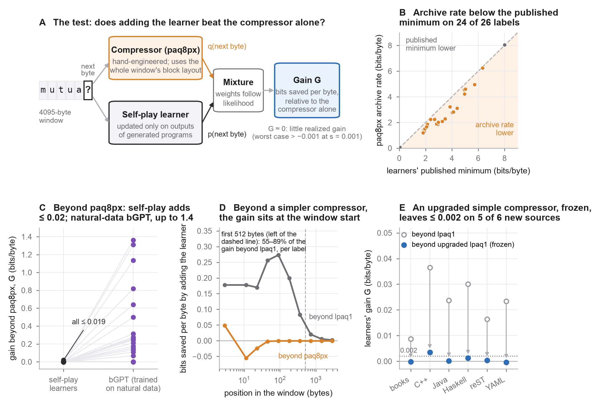

# What Do Zero-Data Self-Play Models Add Beyond an Off-the-Shelf Compressor? A Byte-by-Byte Test

Manuscript, scoring tool and per-byte compressor log losses for:

> Ariel Elboim (2026), *What Do Zero-Data Self-Play Models Add Beyond an Off-the-Shelf Compressor? A Byte-by-Byte
> Test*. Working paper, Version 1.0. https://doi.org/10.5281/zenodo.23058002

Self-play pretraining with zero data (Cowsik et al., 2026) trains byte-level transformers only on outputs of generated
programs. This study asks what the released models add to a strong existing predictor: after the context-mixing
compressor paq8px has assigned a probability to each observed byte, does mixing in the models' predictions lower the
log loss? With paq8px as the reference, the observed mean gain stays below 0.002 bits per byte on three text and formal labels
at all six released sizes, on two labels at eight sampled 24M checkpoints, and on four text, code and JSON sources
fixed before download; a larger, not size-matched natural-data byte model realizes about 0.1 to 1.4 bits per byte on
17 of 24 row sets under the same combiner. Every claim is scoped in the manuscript; the realized gain is not a
measure of information.

## Repository map

| Path | Purpose |
| --- | --- |
| [`paper/`](paper/) | Manuscript (PDF and Markdown source) |
| [`figures/`](figures/) | Figures 1 and 2 of the paper (PNG and PDF) |
| [`tool/`](tool/) | `beyond_compressor.py` (score any model), `test_reproduce.py`, `manifest.json` |
| [`compressor_patches/`](compressor_patches/) | Full replacement source files with logging added (paq8px, lpaq1, and the frozen lpaq1 variant of Section 3.6; GPL-2.0-or-later), build instructions |
| [`provenance/`](provenance/) | All protocols (Batteries 75 to 117) with full SHA-256 and first log record, and the cited audit reports (Appendix H) |
| [`tool/SOURCES.md`](tool/SOURCES.md), [`tool/rebuild/`](tool/rebuild/) | How every row set's windows are rebuilt and verified (original-project, cloud-dependent recipes with saved source pins; ELF not exactly reproducible) |
| [`REPRODUCIBILITY.md`](REPRODUCIBILITY.md) | What reproduces from the released files and how |
| [`public_manifest.json`](public_manifest.json) | SHA-256 inventory of every file in this repository |
| [`CITATION.cff`](CITATION.cff), [`codemeta.json`](codemeta.json) | Citation and research-software metadata |

The per-byte log-loss files (about 300 MB) are in the archived release, https://doi.org/10.5281/zenodo.23058002
(`beyond_compressor_data_v1.0.0.zip`), not in git. Download them
into `tool/data/` and `tool/reference_models/`; `tool/manifest.json` holds the SHA-256 of every file.

## Score your own model

    cd tool
    python beyond_compressor.py list
    python beyond_compressor.py verify --rowset bench__metamath --rows rows.npy
    python beyond_compressor.py score --rowset bench__metamath --probs model_probs.npy --rows rows.npy
    python test_reproduce.py

`model_probs.npy` holds your model's probability of each observed byte, shape `[windows, 4095]`, given the one-byte
prefix `O` and the earlier bytes of the window, in manifest order (the compressors were run on the raw windows).
Probabilities are used as given; zeros are rejected. Raw windows are not redistributed: rebuild them as described in
`tool/SOURCES.md` and check them with `verify`.
